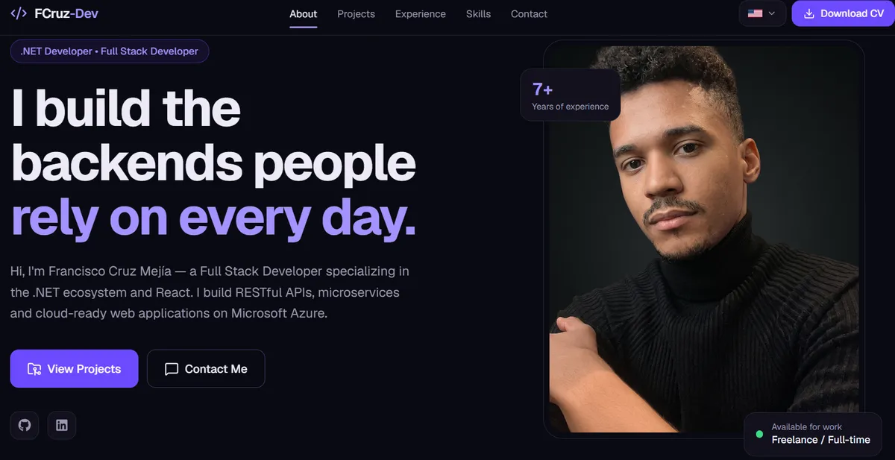

# FCruz-Dev — Professional Portfolio

The personal portfolio of **Francisco Cruz Mejía**, .NET and full stack developer: who I am, the work I have done, the stack I use, my CV and a way to get in touch.



## Features

- **One page, one URL per section.** About, Projects, Experience, Skills and Contact live on a single page; each also has its own address (`/about`, `/projects`, …) that scrolls straight to it, so a section can be linked or bookmarked.
- **English, Spanish and Italian.** The site opens in the language the visitor picked last time, otherwise in their browser's language, otherwise in English. The switcher sits in the navbar (a button group on mobile). `<html lang>`, the page title and the meta description follow the language.
- **Contact form** validated with React Hook Form and Zod and sent through EmailJS. Errors are shown per field, in the current language, and follow a language switch.
- **Downloadable CV** in the visitor's language.
- **Accessible:** semantic landmarks, labelled icon buttons, visible focus and no animations for visitors who ask their OS to reduce motion.
- **Typed content:** every text lives in typed content files, so a translation that misses a field fails the build.

## Tech stack

| Area | Tools |
|---|---|
| UI | React 19, TypeScript, Tailwind CSS v4, Lucide and React Icons |
| Routing | React Router (section URLs on a single page) |
| Forms | React Hook Form, Zod, EmailJS |
| Carousel | Swiper (skills marquee) |
| Build | Vite |
| Tests | Vitest, Testing Library, jsdom |
| Quality | ESLint, TypeScript type checking on every build |
| Hosting | Netlify |

## Getting started

**Requirements:** Node.js 22 or later (the deploy uses Node 24) and npm.

```bash
git clone https://github.com/enmanuel93/fcruz-dev-portfolio.git
cd fcruz-dev-portfolio
npm install
cp .env.example .env.local   # then fill in the values, see below
npm run dev
```

The site runs at <http://localhost:5173>. Everything except sending the contact form works without the environment variables.

## Environment variables

The contact form sends messages through [EmailJS](https://www.emailjs.com), so it needs three values from an EmailJS account. They go in `.env.local` locally (ignored by git) and in Netlify's settings in production. [`.env.example`](.env.example) lists them with the same notes.

| Variable | Where to find it | What it is |
|---|---|---|
| `VITE_EMAILJS_SERVICE_ID` | EmailJS → **Email Services** | The email service connected to the inbox that receives the messages, e.g. `service_abc123`. |
| `VITE_EMAILJS_TEMPLATE_ID` | EmailJS → **Email Templates** | The template each message is sent with, e.g. `template_abc123`. |
| `VITE_EMAILJS_PUBLIC_KEY` | EmailJS → **Account → General** | The account's public key, used to authorise the request. |

**Setting up the template:** the form sends three variables, so the template has to use exactly these names:

| Template variable | Content |
|---|---|
| `{{from_name}}` | The visitor's name (2–50 characters) |
| `{{from_email}}` | The visitor's email, handy as the template's *Reply To* |
| `{{message}}` | The message (10–1000 characters) |

**Good to know**

- Vite only exposes variables that start with `VITE_`, and it writes them into the JavaScript sent to the browser. That is expected for EmailJS, whose public key is meant to be public; protect it by allowing only your domain under EmailJS's *Security* settings. Never put a real secret in a `VITE_` variable.
- If any of the three is missing, the form shows an error message instead of trying to send.
- Values are read at build time: after changing them, restart `npm run dev` or redeploy.

## Scripts

| Command | What it does |
|---|---|
| `npm run dev` | Starts the development server with hot reload |
| `npm run build` | Type-checks, then builds the production site into `dist/` |
| `npm run preview` | Serves the built `dist/` locally |
| `npm run typecheck` | Runs the TypeScript compiler without building |
| `npm run lint` | Runs ESLint |
| `npm test` | Runs the test suite once (`npm run test:watch` to keep it running) |
| `npm run verify` | Lint, tests and build in a row: the check to pass before committing |
| `npm run check:staged` | Checks the staged files before a commit: no `.env` or key files, no secrets, no conflict markers, not on `main`/`master` |

## Project structure

```
src/
├── app/            App shell: providers, router and the order of the sections
├── components/
│   ├── layout/     Navbar, footer, logo and language switcher
│   └── ui/         Generic building blocks (Button, Tag, SectionHeader, …)
├── sections/       One folder per page section, with its own subcomponents
├── data/           Content that reads the same in every language: links, images, skills, routes
├── locales/        The text of each language (en, es, it), checked against a shared type
├── i18n/           Language detection, the locale provider and the useLocale hook
├── hooks/          Scroll-related hooks (active section, reveal on scroll)
├── config/         The only place that reads environment variables
├── lib/            Small helpers
├── styles/         Tailwind theme, keyframes and global styles
└── types/          Shared content types
public/             Static files served as they are: photo, CVs, flags, screenshots
tests/unit/         Tests, mirroring the src/ layout
```

Imports use the `@/` alias for `src/`.

## Editing the content

Components never hard-code text; they read it from the current language.

- **Shared facts** (social links, images, skills, technologies, contact details) are in `src/data/`.
- **Text in each language** is in `src/locales/<language>/`: one file per section, plus `ui.ts` for buttons, headings and labels. Each language must provide every field of the shared type, so the build points out anything left untranslated.
- **The CV** PDFs are in `public/documents/cv/<language>/` and listed in `src/data/cv.ts`.
- **A new project** goes in `src/data/projects.ts` (image, tags, links), with its title and description added in each language. Without a `demoUrl` or `repoUrl`, that button is shown disabled.
- **Testimonials** are in `src/locales/<language>/testimonials.ts`. The section stays hidden while the list is empty.
- **Images** are WebP, about twice their on-screen size, to keep the page light.

## Tests

The suite (Vitest and Testing Library, run in jsdom) checks behaviour the way a visitor meets it rather than implementation details:

- navigation, the mobile menu and section URLs;
- the language switcher, language detection and that every visible or accessible text comes from the current language;
- the contact form: validation, errors, sending, failures and missing configuration;
- the content itself: unique keys, every language listing the same items, and every CV file existing in `public/`.

```bash
npm test                                         # whole suite
npx vitest run tests/unit/sections/contact       # one folder
npx vitest run -t "sends trimmed values"         # one test by name
```

## Deployment

The site is deployed on [Netlify](https://www.netlify.com); [`netlify.toml`](netlify.toml) holds the build setup:

- build command `npm run build`, published folder `dist/`, Node 24;
- every route serves `index.html`, so `/about` or `/contact` work when opened directly or refreshed.

To deploy your own copy: connect the repository in Netlify, add the three `VITE_EMAILJS_*` variables under **Site configuration → Environment variables**, and trigger a deploy. Each push to the main branch deploys again.

## License

© Francisco Cruz Mejía. All rights reserved. The code is public to show how the site is built; please don't reuse the content or the design as your own.
